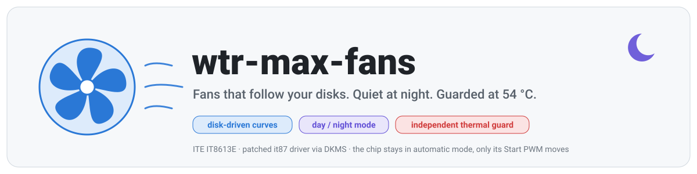
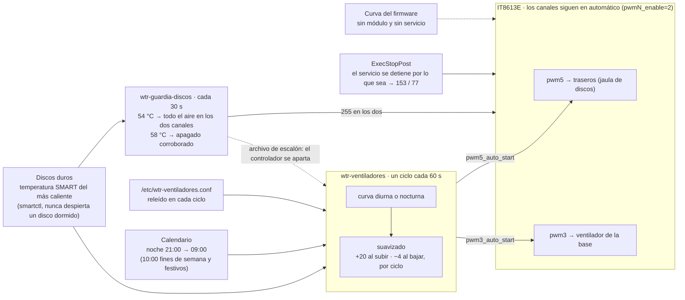
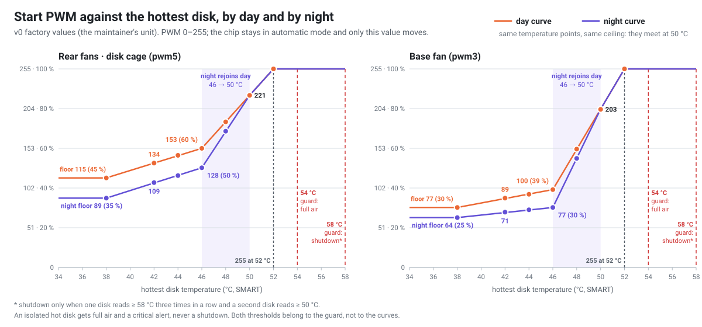
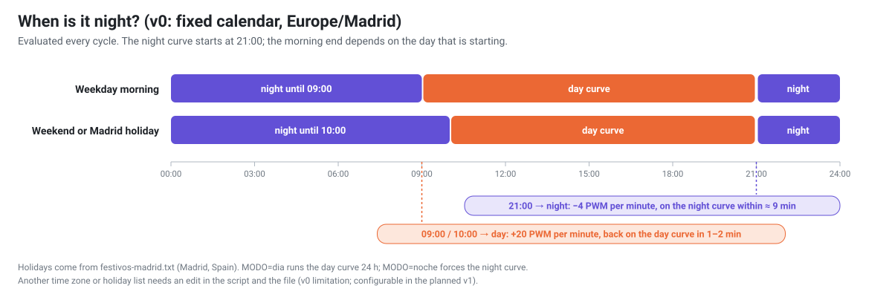
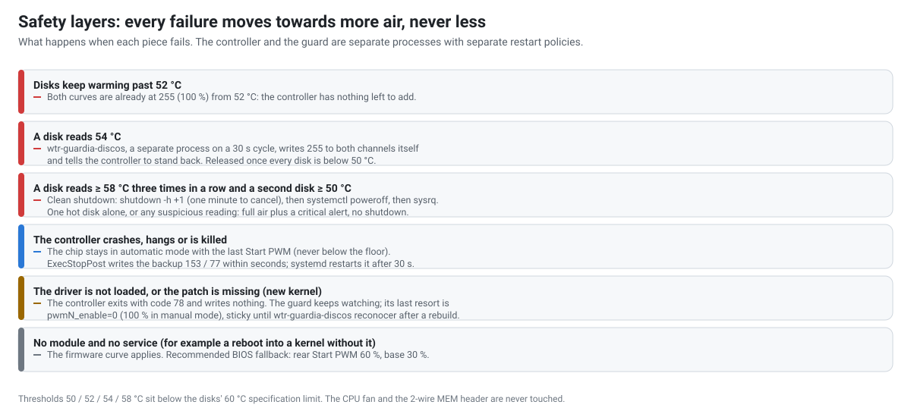

<!--
SPDX-FileCopyrightText: 2026 Gabriel González Pineda <https://github.com/phyrexia>
SPDX-License-Identifier: Apache-2.0
-->

<p align="center">
  <picture>
    <source media="(prefers-color-scheme: dark)" srcset="docs/img/banner-dark.svg">
    
  </picture>
</p>

<p align="center">
  <a href="LICENSE"></a>
  <a href="driver/COPYING"></a>
  
  
  
</p>

<p align="center"><a href="README.md">English</a> · <b>Español</b></p>

Control de ventiladores para el NAS AOOSTAR WTR MAX en Proxmox VE y Debian. Un driver `it87` parchado (DKMS) le da a
Linux los canales de ventilador del ITE IT8613E de la placa; un controlador pequeño hace que los ventiladores traseros y
el de la base sigan al **disco duro más caliente**, con una **curva nocturna** realmente más baja que la diurna; una
**guardia térmica independiente** da todo el aire a 54 °C y solo apaga el equipo cuando dos discos coinciden en que se
está quemando.

> [!WARNING]
> **v0 es el despliegue real del mantenedor, publicado tal cual.** Corrió en exactamente un WTR MAX (Proxmox VE, kernel
> `7.0.14-23-pve`, ventiladores Noctua PWM) y en ningún otro sitio. El código, las claves de configuración y los
> comentarios están en español; el calendario está fijo en Madrid; la guardia apaga por defecto. Lee
> [Estado](#estado-qué-es-y-qué-no-es-v0) y [Limitaciones](#limitaciones-de-v0) antes de instalar. El instalador guiado y
> el producto en inglés (v1) están diseñados en el [ADR 001](docs/adrs/001-wtr-max-fans-architecture.md) y todavía no
> existen.

## Contenido

- [El problema](#el-problema)
- [Cómo funciona](#cómo-funciona) · [las curvas](#las-curvas) · [día y noche](#día-y-noche) · [capas de seguridad](#capas-de-seguridad)
- [Estado: qué es y qué no es v0](#estado-qué-es-y-qué-no-es-v0)
- [Requisitos](#requisitos)
- [Instalación](#instalación)
- [Configuración](#configuración)
- [Operación diaria](#operación-diaria)
- [Limitaciones de v0](#limitaciones-de-v0)
- [Desinstalación](#desinstalación)
- [Pruebas](#pruebas)
- [Preguntas frecuentes](#preguntas-frecuentes)
- [Hoja de ruta](#hoja-de-ruta) · [Licencia](#licencia) · [Marcas](#marcas)

## El problema

El firmware del WTR MAX mueve los ventiladores según dos termistores de la placa base. Esos sensores no están en la
jaula de discos: en el equipo del mantenedor, mientras los seis discos duros bajaban 3–8 °C en 35 minutos, los sensores
de la placa se movieron 1–2 °C. La curva del firmware reacciona a la placa, no a los discos que debería proteger.

Eso no importaba con los ventiladores de fábrica, que ignoraban la curva y giraban a tope. Al cambiarlos por
ventiladores PWM de 4 pines, la curva del firmware se volvió real: los traseros, los únicos que soplan a través de la
jaula de discos, quedaron casi detenidos, y los discos subieron de 33–37 °C a 53 °C en reposo, con un máximo de 56 °C.

Arreglarlo desde Linux choca con una segunda pared: el driver `it87` del kernel no conoce el IT8613E (`modprobe it87`
responde «No such device»), y forzarlo con `force_id` oculta el tacómetro de los traseros y lee mal los registros de
control. El driver fuera de árbol [`frankcrawford/it87`](https://github.com/frankcrawford/it87) sí soporta el chip, pero
un error de una línea en el mapeo de atributos oculta justo el atributo de sysfs que este proyecto necesita en el
canal de los traseros. De ahí la compilación por DKMS y el parche de tres líneas de [`driver/`](driver/README.md).

## Cómo funciona



**Modo híbrido.** El chip sigue ejecutando su propia curva automática (`pwmN_enable=2`); el controlador aplana esa
curva una vez (Off 0 °C, Start 0 °C, Full 80 °C, pendiente 0) para que el chip entregue siempre su *Start PWM*, y
después solo escribe `pwmN_auto_start`. Nunca escribe `pwmN` ni pasa un canal a manual. Si el controlador muere, el chip
conserva el último Start PWM, que nunca está por debajo del piso, y `ExecStopPost` deja los valores de respaldo (traseros
153, base 77) en segundos. Sin el atributo del driver parchado en los dos canales, el controlador sale con código 78 y
no escribe nada.

**Entrada.** Cada 60 s, `smartctl -j -n standby -A` en cada disco rotacional; solo cuenta `temperature.current`. Un disco
dormido nunca se despierta. La temperatura de control es la del disco más caliente. Las lecturas inverosímiles se
descartan (fuera de 5–90 °C, o un salto de más de 10 °C); un salto que persiste pasa a ser la base nueva solo por
debajo de 50 °C; si no, cuenta para dar aire pero nunca para apagar. Sin ningún disco legible durante tres ciclos → 255.
Todos los discos dormidos → el piso.

**Suavizado.** Sube como mucho 20 PWM por ciclo (el 255 se aplica entero). Baja 4 por ciclo, tras tres ciclos con el
objetivo al menos 6 por debajo, o tras diez ciclos seguidos con el objetivo por debajo por poco que sea. Un
ventilador que lee 0 rpm durante tres ciclos con su PWM en el piso o por encima pone el otro canal a 255 y dispara una
alerta.

### Las curvas

<picture>
  <source media="(prefers-color-scheme: dark)" srcset="docs/img/curves-dark.svg">
  
</picture>

Los dos canales comparten los puntos de temperatura: piso hasta 38 °C, un nivel cómodo a 46 °C, las dos curvas se
encuentran a 50 °C y 255 (100 %) desde 52 °C. La curva nocturna va estrictamente por debajo de la diurna en toda
temperatura hasta 49 °C y es idéntica desde 50 °C: el techo y la guardia no saben qué hora es.

| Disco más caliente | Traseros, día | Traseros, noche | Base, día | Base, noche |
|---|---|---|---|---|
| ≤ 38 °C | 115 (45 %) | **89** (35 %) | 77 (30 %) | **64** (25 %) |
| 42 °C | 134 | **109** | 89 | **71** |
| 44 °C | 144 | **118** | 94 | **74** |
| 46 °C | 153 (60 %) | **128** (50 %) | 100 (39 %) | **77** (30 %) |
| 48 °C | 187 | **175** | 152 | **140** |
| 50 °C | 221 | 221 | 203 | 203 |
| ≥ 52 °C | 255 | 255 | 255 | 255 |

Los pisos nocturnos no son suposiciones: 89 en los traseros marcó 708 rpm y 64 en la base marcó 511 rpm en el
tacómetro, estables durante tres minutos y con margen sobre el mínimo de la ficha de cada ventilador. A 42 °C, la
temperatura nocturna habitual en el equipo del mantenedor, la curva nocturna mueve los traseros un 17 % más lento y la
base un 29 % más lento que la diurna. «Noche igual a día» se rechaza como error de configuración (la curva vuelve a los
valores de fábrica y una métrica lo acusa); para tener la curva diurna todo el día existe `MODO=dia`.

### Día y noche

<picture>
  <source media="(prefers-color-scheme: dark)" srcset="docs/img/schedule-dark.svg">
  
</picture>

A las 21:00 los dos canales bajan 4 PWM por minuto (unas 30 rpm por minuto en los traseros) y llegan a la curva
nocturna en unos nueve minutos; a las 09:00 o 10:00 vuelven a subir a 20 por minuto. En v0 el calendario es fijo: zona
horaria `Europe/Madrid`, festivos de `festivos-madrid.txt`.

### Capas de seguridad

<picture>
  <source media="(prefers-color-scheme: dark)" srcset="docs/img/safety-layers-dark.svg">
  
</picture>

La guardia, `wtr-guardia-discos`, es un proceso aparte que no importa nada del controlador y nunca muere porque una
acción falle. Su escalera:

| Escalón | Cuándo | Qué hace |
|---|---|---|
| 1 · todo el aire | algún disco ≥ 54 °C (se retira bajo 50 °C) | escribe 255 en los dos canales por sí misma y refresca un archivo de escalón que el controlador respeta |
| 2 · apagado | un disco ≥ 58 °C en tres lecturas seguidas **y** un segundo disco ≥ 50 °C en dos de ellas, sin lecturas sospechosas | marcador persistente, luego `shutdown -h +1` (un minuto para cancelar con `shutdown -c`), luego `systemctl poweroff`, luego sysrq |
| 3 · disco aislado | un disco ≥ 58 °C tres veces, sin corroboración | todo el aire y alerta crítica, **sin apagar** |
| 4 · ciega | sin ninguna lectura durante 5 minutos | todo el aire, sin apagar |
| 5 · cautela | menos de 30 minutos desde un arranque posterior a un apagado térmico | no apaga salvo que corroboren tres discos |

Si falta `pwmN_auto_start` (DKMS reconstruido sin el parche), el último recurso de la guardia es `pwmN_enable=0`: 100 %
en modo manual, y así se queda hasta que un administrador reconstruya el driver y ejecute
`wtr-guardia-discos reconocer`.

## Estado: qué es y qué no es v0

| | v0 (este repositorio, hoy) | v1 (diseñada, no escrita) |
|---|---|---|
| Qué es | el despliegue del mantenedor del 2026-10-13/14, publicado tal cual | un producto para otros dueños |
| Probado en | un WTR MAX: Proxmox VE, kernel `7.0.14-23-pve`, ventiladores PWM Noctua NF-A12x25 (traseros) y NF-P12 (base) | — |
| Idioma | código, claves, comentarios y subcomandos en español | inglés, con menú y CLI |
| Instalación | pasos manuales de DKMS más `instalar.sh` | `git clone` + `sudo ./install.sh` con puerta de identidad y asistente de calibración |
| Comprobaciones de hardware | ninguna: asume el mapa de canales del mantenedor | DMI + ID del Super-I/O + prueba de respuesta PWM por canal |
| Calendario nocturno | fijo en Madrid | hora local, opción de fin de semana, archivo de festivos opcional |
| Acción de la guardia | **apagar** (`ACCION=apagar`) | alertar; apagar es opcional |
| Perfiles | los valores del mantenedor | `quiet` / `balanced` / `cool`, elegidos con una prueba de ruido |

El diseño de v1 (arquitectura, perfiles, calibración, modos de falla, CI) está en el
[ADR 001](docs/adrs/001-wtr-max-fans-architecture.md); las preguntas que responde están en el
[grill](docs/specs/2026-10-13-wtr-max-fans-grill.md). Mientras v1 no exista, trata a v0 como una referencia que puedes
leer, adaptar y ejecutar bajo tu responsabilidad, no como algo para instalar a ciegas.

## Requisitos

- Un AOOSTAR WTR MAX. Nada aquí comprueba que lo sea; en cualquier otra placa quedas por tu cuenta (el driver sondea el
  chip, el mapa de canales se da por supuesto).
- **Ventiladores PWM de 4 pines** en los conectores SYS (base) y SATA (traseros). Los de fábrica del equipo del
  mantenedor no eran PWM: giraban a tope dijera lo que dijera el registro, y nada puede frenarlos por software.
- Proxmox VE 8/9 o Debian 12/13, Python ≥ 3.11 (solo biblioteca estándar), `smartmontools`, `dkms`, `gcc` y los headers
  del kernel en uso.
- Root. Los dos servicios escriben en sysfs y leen SMART por `SG_IO`.
- Opcional: un `node_exporter` de Prometheus con el colector textfile en `/var/lib/prometheus/node-exporter` (los dos
  servicios escriben ahí sus métricas; las reglas de alerta de [`contrib/prometheus/`](contrib/prometheus/) son
  ejemplos, no se instalan).

## Instalación

Todo lo de abajo corre como root en el WTR MAX. El paso más largo es la compilación por DKMS (unos dos minutos en esta
CPU); la fase de simulación del paso 2 es la que vale la pena esperar.

<details>
<summary><b>Paso 1 — el driver: commit fijado, parche, DKMS</b> (detalle completo en <a href="driver/README.md">driver/README.md</a>)</summary>

```bash
# Compilador, DKMS y los headers del kernel en uso (en Proxmox VE el metapaquete trae también los futuros).
apt-get install -y --no-install-recommends dkms gcc proxmox-default-headers smartmontools

# Fuente upstream fijada.
mkdir -p /root/src && cd /root/src
git clone https://github.com/frankcrawford/it87.git it87
cd it87 && git checkout bd7a566c8a60fe0308d67e26761e16260368191a
sha256sum it87.c    # b11c5dd669b6a2a38ad39952784bfeff320e539843d22639c97cf6a11d25d703 (sin parche)

# El parche de tres líneas de este repositorio (copia driver/0001-it87-expose-pwm4-6-auto-start.patch a /root/src/).
sha256sum /root/src/0001-it87-expose-pwm4-6-auto-start.patch   # b145523cad39dc70ca2016f9750fbfdb06bb364382534d05f2e4bba6d85ebf54
git checkout -b wtrmax/auto-start-pwm4-6
git -c user.name="wtr-max-fans" -c user.email="root@wtrmax.invalid" am /root/src/0001-it87-expose-pwm4-6-auto-start.patch
sha256sum it87.c    # 183d4a80d286dbee70b23178b146ee9f24ecd622c54ca7301c7944b4207df7e5 (con parche)

# DKMS con su propia cadena de versión: add, build, install y modprobe de una vez.
V=v2.0-6-gbd7a566.20261002.wtr1
make -f Makefile DRIVER=it87 DRIVER_VERSION=$V DKMS_ROOT_PATH=/usr/src/it87-$V dkms

# Carga al arrancar, sin opciones del módulo.
install -m 0644 /ruta/a/wtr-max-fans/v0/it87.conf /etc/modules-load.d/it87.conf

# Comprobación: el chip está y existen los atributos parchados.
H=$(ls -d /sys/devices/platform/it87.2608/hwmon/hwmon*)
cat $H/name                                  # it8613
ls $H/pwm3_auto_start $H/pwm5_auto_start     # deben existir los dos
```

Si tras una actualización `dkms status` no muestra el módulo compilado para el kernel nuevo, no reinicies hasta
resolverlo: sin el módulo los ventiladores vuelven a la curva del firmware y el controlador queda quieto (salida 78).

</details>

<details>
<summary><b>Paso 2 — los servicios, por fases</b> (<code>instalar.sh</code> no deja saltárselas)</summary>

Copia el directorio `v0/` al equipo (por ejemplo a `/root/wtr-max-fans/v0`) y, desde ahí:

```bash
bash instalar.sh guardia          # 1. primero la guardia: protege desde este momento
bash instalar.sh probar-sandbox   #    comprueba smartctl y un apagado en seco (-k) bajo el sandbox de la unidad
bash instalar.sh simular          # 2. el controlador en --simular: una línea de journal por ciclo, cero escrituras
                                  #    míralo ~30 min: journalctl -u wtr-ventiladores -f
bash instalar.sh instalar         # 3. el controlador real; termina con verificar
bash instalar.sh verificar        #    en cualquier momento: sale 1 si algo no cuadra
```

`verificar` comprueba la versión de DKMS para el kernel en uso, los dos atributos `auto_start`, que las dos unidades
estén habilitadas y activas, que los scripts instalados coincidan con los del repositorio, que no quede el drop-in de
simulación, que la guardia esté en `ACCION=apagar`, que el archivo de configuración tenga las claves actuales y que las
métricas estén frescas.

</details>

<details>
<summary><b>Paso 3 — el respaldo en el firmware (recomendado, una vez, con consola)</b></summary>

En la pantalla «Smart Fan» de la BIOS, pon **SATA FAN Start PWM en 60 % (153)** y **SYS FAN Start PWM en 30 % (77)**.
Es el único respaldo que sobrevive a «sin módulo y sin servicio»; con los servicios corriendo no cambia nada.

</details>

## Configuración

`/etc/wtr-ventiladores.conf` se relee en cada ciclo; no hace falta reiniciar. El instalador nunca pisa un archivo que
editaste: solo reemplaza una copia sin editar de una versión distribuida antes (conservando `.anterior-<fecha>`), y si
no, imprime el diff y las claves que te faltan. Una clave ausente toma el valor de fábrica; un valor inválido toma el de
fábrica y pone `wtr_ventiladores_config_ok` en 0; una curva incoherente devuelve la curva entera a fábrica.

| Clave | Fábrica | Significado |
|---|---|---|
| `MODO` | `auto` | `auto` sigue el calendario; `dia` corre la curva diurna 24 h; `noche` fuerza la nocturna |
| `T_PISO_C` / `T_SILENCIO_C` / `T_CONVERGE_C` / `T_MAX_C` | 38 / 46 / 50 / 52 | los puntos de temperatura, comunes a los dos canales |
| `PISO_SATA` / `SILENCIO_SATA` | 115 / 153 | traseros de día: piso y nivel a 46 °C |
| `PISO_NOCHE_SATA` / `NOCHE_SATA` | 89 / 128 | traseros de noche |
| `PISO_SYS` / `SILENCIO_SYS` | 77 / 100 | base de día |
| `PISO_NOCHE_SYS` / `NOCHE_SYS` | 64 / 77 | base de noche |
| `RESPALDO_SATA` / `RESPALDO_SYS` | 153 / 77 | lo que deja `ExecStopPost`; valores diurnos a propósito |
| `PASO_SUBIDA` / `PASO_BAJADA` | 20 / 4 | PWM por ciclo al subir y al bajar |
| `BANDA_MUERTA` / `CICLOS_BAJADA` / `CICLOS_CONVERGENCIA` | 6 / 3 / 10 | cuándo empieza una bajada |
| `DISCOS` | vacío | vacío = descubrir los discos ATA rotacionales; una lista de `/dev/...` para pruebas |

Invariantes, por canal: `51 ≤ PISO_NOCHE < PISO ≤ SILENCIO`, `PISO_NOCHE ≤ NOCHE < SILENCIO`, `RESPALDO ≥ PISO`. No se
acepta ningún valor por debajo de 51 (20 %) en ninguna parte.

`/etc/wtr-guardia-discos.conf` (releído cada 30 s): `ACCION=apagar|simulacro`, umbrales `ESCALON_C=54`, `RETIRO_C=50`,
`APAGADO_C=58`, `CORROBORA_C=50`, `CAUTELA_MIN=30`, `CICLOS_CIEGA=10`.

## Operación diaria

```bash
wtr-ventiladores estado                          # configuración, modo, sysfs y lecturas de los discos
wtr-ventiladores decidir --en 2026-10-17T09:30   # qué modo tocaría en ese instante
journalctl -u wtr-ventiladores -n 20             # una línea por ciclo: T, modo y, por canal, objetivo / diurno / aplicado
journalctl -u wtr-guardia-discos                 # cambios de estado, escrituras y apagados
wtr-guardia-discos reconocer                     # tras un apagado térmico o un manual de emergencia
```

Una línea del journal dice `T=42 modo=noche sys obj=71 dia=89 apl=71 sata obj=109 dia=134 apl=109 estado=ok`: de
noche, `apl` por debajo de `dia` en los dos canales es «más silencioso que de día» en números.

- **Cancelar un apagado de la guardia**: `shutdown -c` en el minuto de gracia. Si las condiciones siguen, la guardia lo
  vuelve a programar a los cinco minutos; detén la guardia o resuelve la causa.
- **Tras actualizar el kernel**: `dkms status it87` debe listar el kernel nuevo antes de reiniciar. Si tras el reinicio
  el controlador sale con 78, reconstruye el driver con el parche y, si algún canal quedó en manual de emergencia,
  ejecuta `wtr-guardia-discos reconocer`.
- **Métricas**: `/var/lib/prometheus/node-exporter/wtr_ventiladores.prom` y `wtr_guardia_discos.prom` (objetivos,
  objetivos diurnos, aplicados, estado, `config_ok`, estado de la guardia). Las ocho alertas de ejemplo de
  [`contrib/prometheus/`](contrib/prometheus/) necesitan reemplazar `instance="wtr-max:9100"` por tu target del
  node_exporter.

<details>
<summary><b>Calibrar un piso con tus ventiladores</b></summary>

Con el controlador parado (`ExecStopPost` deja el respaldo), `calibrar` sostiene un PWM, imprime las rpm cada 10 s y
una fila para la tabla, aborta si un disco llega a 50 °C y vuelve al respaldo al terminar, también con Ctrl-C.

```bash
systemctl stop wtr-ventiladores
wtr-ventiladores calibrar --canal pwm5 --pwm 89 --minutos 3
wtr-ventiladores calibrar --canal pwm3 --pwm 64 --minutos 3
systemctl start wtr-ventiladores
```

Un piso se acepta solo si el tacómetro es estable (ninguna lectura 0 ni ausente, `(máx − mín) / media ≤ 5 %`) **y**
tiene margen (≥ 100 rpm sobre el mínimo de la ficha menos su tolerancia del 20 %). En el equipo del mantenedor:
traseros 89 → 708 rpm (aceptado), base 64 → 511 rpm (aceptado), base 51 → 274 rpm (estable, pero solo 34 rpm sobre el
límite: rechazado).

</details>

## Limitaciones de v0

- **Comprobación del hostname.** `instalar.sh` se niega a correr si el nombre corto del equipo no es `wtrmax`
  (`hostname -s`). Renombra el equipo o edita esa línea; v1 lo reemplaza por una comprobación de identidad del hardware.
- **Madrid, fijo.** Zona horaria `Europe/Madrid` y lista de festivos `festivos-madrid.txt`. Otra zona exige editar
  `ZONA` en `wtr-ventiladores`; otra lista de festivos, otro archivo. Los fines de semana y festivos la noche termina a
  las 10:00 en vez de a las 09:00.
- **La guardia apaga por defecto.** `ACCION=apagar` en `/etc/wtr-guardia-discos.conf`. Para que solo registre y
  alerte, pon `ACCION=simulacro`: se escriben el marcador y la métrica, no se ejecuta nada. Ten en cuenta que
  `instalar.sh verificar` lo reporta y que la alerta de ejemplo `WtrGuardiaDiscosCaida` se dispara a propósito, porque
  una guardia que no puede apagar no protege.
- **El mapa de canales se da por supuesto**: `pwm5` = traseros, `pwm3` = base, `pwm2` = CPU (sin tocar), `pwm4` = MEM
  (sin tocar; un ventilador de 2 hilos en el equipo del mantenedor). Si tus ventiladores están cableados distinto, el
  ventilador equivocado sigue a los discos. v1 lo mide al instalar.
- **Todo en español**: subcomandos (`correr`, `respaldo`, `estado`, `decidir`, `calibrar`, `bios`, `vigilar`,
  `reconocer`, `probar-sandbox`), claves de configuración, líneas del journal, métricas (`wtr_ventiladores_*`,
  `wtr_guardia_discos_*`).
- **Secure Boot no se probó.** DKMS firma el módulo con su propia llave MOK, que hay que inscribir para que el módulo
  cargue (ver `driver/README.md`).
- **Sin puerta de identidad del hardware**: nada se niega a correr en una placa que no sea un WTR MAX.

## Desinstalación

```bash
bash instalar.sh revertir                     # retira el controlador; ExecStopPost deja traseros 153 / base 77
bash instalar.sh revertir --bios              # además devuelve Start temp 20 °C y Start PWM 100 del firmware
bash instalar.sh revertir --tambien-guardia   # también la guardia (conserva /var/lib/wtr-guardia-discos)
```

Los archivos de configuración se renombran a `.retirado-<fecha>`. Reiniciar devuelve siempre los ventiladores a la
curva del firmware. Para quitar el driver y el paquete DKMS, sigue «Revert» en
[`driver/README.md`](driver/README.md).

## Pruebas

94 pruebas unitarias (71 del controlador, 23 de la guardia) con sysfs, `smartctl` y `shutdown` falsos, más `promtool`
sobre las reglas de alerta y `shellcheck` sobre el instalador. No hace falta hardware:

```bash
python3 -m unittest discover -s v0 -p 'test_*.py' -v
promtool check rules contrib/prometheus/prometheus-alertas-wtr-ventiladores.yml
promtool test rules contrib/prometheus/prometheus-alertas-wtr-ventiladores.test.yml
shellcheck v0/instalar.sh
```

Sobre el hardware, la spec del mantenedor define las pruebas H0–H14 (valores de `preparar`, `kill -9` del controlador,
`modprobe -r` y vuelta, una noche forzada de día, la primera noche real, migración de la configuración, el camino de la
alerta). Sus resultados están registrados en el repositorio privado del mantenedor; las cifras que cita este README
salen de ahí.

## Preguntas frecuentes

**¿Mis ventiladores son PWM?** Los PWM tienen cuatro pines. En este chip, un ventilador de 3 pines o de 2 hilos gira
a lo que le dé el conector y no se puede frenar por software; su tacómetro lee 0 o nada. Cámbialo por uno PWM de 4 pines
para tener control.

**¿Por qué no `fancontrol` o fan2go?** Usan el modo manual del chip: si el proceso muere, el chip conserva el último
ciclo de trabajo para siempre, lo que puede dejar un ventilador detenido. Este proyecto mantiene el chip en automático y
solo mueve el Start PWM, así que un demonio muerto significa «último valor, nunca bajo el piso», no «último valor,
quizá cero».

**¿Por qué no el `it87` del kernel?** No conoce el IT8613E. Con `force_id=0x8622` oculta el tacómetro de los traseros y
lee `pwm4`/`pwm5` de los registros de salida en vez de los de control. Nunca escribas `pwm*` por ese driver en esta
placa.

**¿Qué hace el parche?** En `it87_auto_pwm_is_visible()` los seis atributos de `pwm4..6` se mapean sobre la
distribución de once entradas de `pwm1..3`, y `auto_start` cae en el índice de un atributo oculto. Tres líneas corren el
índice. El único efecto visible es que aparecen `pwm4_auto_start` y `pwm5_auto_start`; escriben el mismo registro que
la BIOS llama «Start PWM». El parche no se envía upstream (decisión del mantenedor).

**¿Qué pasa cuando actualizo el kernel?** DKMS reconstruye el módulo cuando están los headers nuevos
(`proxmox-default-headers` los trae). Revisa `dkms status it87` antes de reiniciar. Sin el módulo, los ventiladores
quedan en la curva del firmware, el controlador se queda quieto con salida 78 y la guardia no puede escribir.

**¿Despierta alguna vez un disco dormido?** No. `smartctl -n standby` vuelve sin tocar un disco en standby; todos los
discos dormidos significa el piso.

**¿Puedo correr la curva diurna todo el tiempo?** `MODO=dia`. Poner los valores nocturnos iguales a los diurnos se
rechaza a propósito: esa igualdad silenciosa es exactamente lo que hizo que la primera noche del mantenedor no fuera
más silenciosa.

**¿Hacia dónde soplan los ventiladores?** De adelante hacia atrás: el aire entra por el frente, cruza los discos y
sale por los traseros. Deja los ventiladores como vienen instalados.

## Hoja de ruta

v1, diseñada en el [ADR 001](docs/adrs/001-wtr-max-fans-architecture.md): `git clone` + `sudo ./install.sh`, una
puerta de identidad (DMI, ID del Super-I/O, nombre del hwmon), un asistente de calibración que mide qué ventilador
responde al PWM y cuál es cuál, perfiles `quiet` / `balanced` / `cool` elegidos con una prueba de ruido, un calendario
nocturno genérico, alertar como acción por defecto de la guardia con el apagado opcional, un menú whiptail con
equivalentes de CLI, desinstalación limpia que restaura los números propios del firmware, y CI que compila el driver
contra headers de Debian y Proxmox VE. Los pendientes se siguen en [`tasks/todo.md`](tasks/todo.md).

## Licencia

- Todo salvo `driver/` es **Apache-2.0** ([`LICENSE`](LICENSE)); las redistribuciones deben conservar el archivo
  [`NOTICE`](NOTICE).
- `driver/0001-it87-expose-pwm4-6-auto-start.patch` modifica el driver `it87`, que es GPL-2.0, y es **GPL-2.0-only**
  ([`driver/COPYING`](driver/COPYING)). El driver y los servicios son programas separados que solo comparten sysfs.
- Cada archivo lleva encabezados SPDX.

Autor: Gabriel González Pineda ([@phyrexia](https://github.com/phyrexia)). Trabajo previo que dio forma al diseño:
[`frankcrawford/it87`](https://github.com/frankcrawford/it87), [fan2go](https://github.com/markusressel/fan2go),
[hddfancontrol](https://github.com/desbma/hddfancontrol) y `pwmconfig` de lm-sensors.

## Marcas

«AOOSTAR» y «WTR MAX» identifican el hardware de forma descriptiva. Este proyecto no está afiliado a AOOSTAR, ni
patrocinado ni respaldado por AOOSTAR. ("AOOSTAR" and "WTR MAX" identify the hardware descriptively. This project is
not affiliated with, sponsored by or endorsed by AOOSTAR.) Noctua es una marca de su titular; los modelos de ventilador se
nombran solo para informar lo que se midió.
