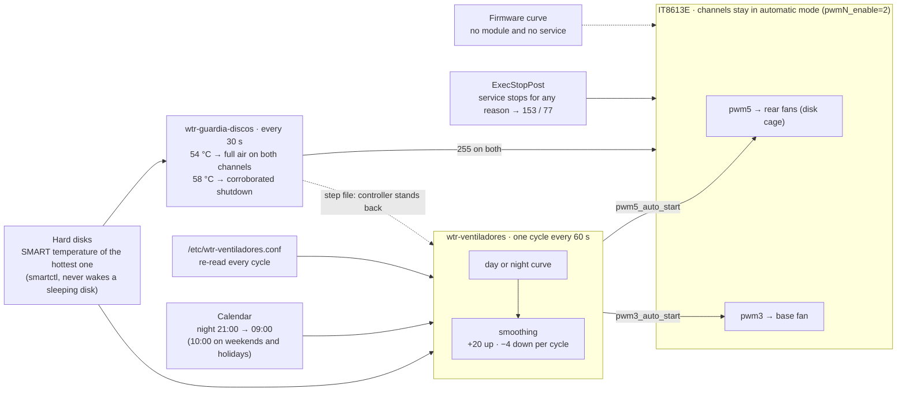

<!--
SPDX-FileCopyrightText: 2026 Gabriel González Pineda <https://github.com/phyrexia>
SPDX-License-Identifier: Apache-2.0
-->

<p align="center">
  <picture>
    <source media="(prefers-color-scheme: dark)" srcset="docs/img/banner-dark.svg">
    
  </picture>
</p>

<p align="center">
  <a href="LICENSE"></a>
  <a href="driver/COPYING"></a>
  
  
  
</p>

<p align="center"><b>English</b> · <a href="README.es.md">Español</a></p>

Fan control for the AOOSTAR WTR MAX NAS on Proxmox VE and Debian. A patched `it87` driver (DKMS) gives Linux the fan
channels of the board's ITE IT8613E; a small controller makes the rear and base fans follow the **hottest hard disk**,
with a **night curve** that is really lower than the day curve; an **independent thermal guard** gives full air at 54 °C and
only shuts the machine down when two disks agree it is burning.

> [!WARNING]
> **v0 is the maintainer's real deployment, published as is.** It has run on exactly one WTR MAX (Proxmox VE, kernel
> `7.0.14-23-pve`, Noctua PWM fans) and nowhere else. Code, configuration keys and comments are in Spanish; the calendar
> is hard-wired to Madrid; the guard shuts down by default. Read [Status](#status-what-v0-is-and-is-not) and
> [Limitations](#limitations-of-v0) before installing. The guided installer and the English product (v1) are designed in
> [ADR 001](docs/adrs/001-wtr-max-fans-architecture.md) and do not exist yet.

## Contents

- [The problem](#the-problem)
- [How it works](#how-it-works) · [the curves](#the-curves) · [day and night](#day-and-night) · [safety layers](#safety-layers)
- [Status: what v0 is and is not](#status-what-v0-is-and-is-not)
- [Requirements](#requirements)
- [Install](#install)
- [Configure](#configure)
- [Day-to-day](#day-to-day)
- [Limitations of v0](#limitations-of-v0)
- [Uninstall](#uninstall)
- [Tests](#tests)
- [FAQ](#faq)
- [Roadmap](#roadmap) · [License](#license) · [Trademarks](#trademarks)

## The problem

The WTR MAX firmware drives the fans from two thermistors on the mainboard. Those sensors are not in the disk cage: on
the maintainer's unit, while the six hard disks cooled by 3–8 °C over 35 minutes, the board sensors moved by 1–2 °C.
The firmware curve therefore reacts to the board, not to the disks it is supposed to protect.

That was harmless with the stock fans, which ignored the curve and ran at full speed. After swapping them for 4-pin PWM
fans, the firmware curve became real: the rear fans, the only ones blowing through the disk cage, were left almost
stopped, and the disks climbed from 33–37 °C to 53 °C while idle, peaking at 56 °C.

Fixing it from Linux hits a second wall: the mainline `it87` driver does not know the IT8613E (`modprobe it87` answers
"No such device"), and forcing it with `force_id` hides the rear-fan tachometer and misreads the control registers. The
out-of-tree [`frankcrawford/it87`](https://github.com/frankcrawford/it87) driver supports the chip, but a one-line
attribute-mapping bug hides the exact sysfs attribute this project needs on the rear-fan channel. Hence the DKMS build
and the three-line patch in [`driver/`](driver/README.md).

## How it works



**Hybrid mode.** The chip keeps running its own automatic curve (`pwmN_enable=2`); the controller flattens that curve
once (Off 0 °C, Start 0 °C, Full 80 °C, slope 0) so that the chip always outputs its *Start PWM*, and then only writes
`pwmN_auto_start`. It never writes `pwmN` and never switches a channel to manual. If the controller dies, the chip keeps
the last Start PWM, which is never below the floor, and `ExecStopPost` leaves the backup values (rear 153, base 77)
within seconds. Without the patched driver attribute on both channels, the controller exits with code 78 and writes
nothing at all.

**Input.** Every 60 s, `smartctl -j -n standby -A` on each rotational disk; only `temperature.current` counts. A
sleeping disk is never woken. The control temperature is the hottest disk. Implausible readings are discarded (outside
5–90 °C, or a jump of more than 10 °C); a jump that persists becomes the new base only below 50 °C, otherwise it counts
for giving air but never for shutting down. No readable disk for three cycles → 255. All disks asleep → the floor.

**Smoothing.** Up at most 20 PWM per cycle (255 is applied whole). Down 4 per cycle, after three cycles with the target at
least 6 below, or after ten consecutive cycles with the target below by any amount. A fan reading 0 rpm for three
cycles with its PWM at or above the floor puts the other channel at 255 and raises an alert.

### The curves

<picture>
  <source media="(prefers-color-scheme: dark)" srcset="docs/img/curves-dark.svg">
  
</picture>

Both channels share the temperature points: floor up to 38 °C, a comfortable level at 46 °C, the two curves meet at
50 °C, and 255 (100 %) from 52 °C. The night curve is strictly below the day curve for every temperature up to 49 °C and
identical from 50 °C: the ceiling and the guard do not know what time it is.

| Hottest disk | Rear, day | Rear, night | Base, day | Base, night |
|---|---|---|---|---|
| ≤ 38 °C | 115 (45 %) | **89** (35 %) | 77 (30 %) | **64** (25 %) |
| 42 °C | 134 | **109** | 89 | **71** |
| 44 °C | 144 | **118** | 94 | **74** |
| 46 °C | 153 (60 %) | **128** (50 %) | 100 (39 %) | **77** (30 %) |
| 48 °C | 187 | **175** | 152 | **140** |
| 50 °C | 221 | 221 | 203 | 203 |
| ≥ 52 °C | 255 | 255 | 255 | 255 |

The night floors are not guesses: 89 on the rear fans read 708 rpm and 64 on the base fan read 511 rpm on the
tachometer, stable over three minutes and with margin over the fan datasheets' minimum. At 42 °C, the usual night
temperature on the maintainer's unit, the night curve runs the rear fans 17 % slower and the base fan 29 % slower than
the day curve. "Night equal to day" is rejected as a configuration error (the curve falls back to factory values and a
metric says so); to run the day curve all day there is `MODO=dia`.

### Day and night

<picture>
  <source media="(prefers-color-scheme: dark)" srcset="docs/img/schedule-dark.svg">
  
</picture>

At 21:00 both channels slide down 4 PWM per minute (about 30 rpm per minute on the rear fans) and reach the night curve
in roughly nine minutes; at 09:00 or 10:00 they come back up at 20 per minute. In v0 the calendar is fixed: time zone
`Europe/Madrid`, holidays from `festivos-madrid.txt`.

### Safety layers

<picture>
  <source media="(prefers-color-scheme: dark)" srcset="docs/img/safety-layers-dark.svg">
  
</picture>

The guard, `wtr-guardia-discos`, is a separate process that imports nothing from the controller and never dies because
an action failed. Its ladder:

| Step | When | What it does |
|---|---|---|
| 1 · full air | any disk ≥ 54 °C (released below 50 °C) | writes 255 to both channels itself and refreshes a step file the controller honours |
| 2 · shutdown | one disk ≥ 58 °C on three consecutive readings **and** a second disk ≥ 50 °C on two of them, with no suspicious readings | persistent marker, then `shutdown -h +1` (one minute to cancel with `shutdown -c`), then `systemctl poweroff`, then sysrq |
| 3 · isolated disk | one disk ≥ 58 °C three times, no corroboration | full air and a critical alert, **no shutdown** |
| 4 · blind | no reading at all for 5 minutes | full air, no shutdown |
| 5 · caution | less than 30 minutes since a boot that followed a thermal shutdown | does not shut down unless three disks corroborate |

If `pwmN_auto_start` is missing (DKMS rebuilt without the patch), the guard's last resort is `pwmN_enable=0`: 100 % in
manual mode, sticky until an administrator rebuilds the driver and runs `wtr-guardia-discos reconocer`.

## Status: what v0 is and is not

| | v0 (this repository, today) | v1 (designed, not written) |
|---|---|---|
| What it is | the maintainer's deployment of 2026-10-13/14, published as is | a product for other owners |
| Tested on | one WTR MAX: Proxmox VE, kernel `7.0.14-23-pve`, Noctua NF-A12x25 (rear) and NF-P12 (base) PWM fans | — |
| Language | Spanish code, keys, comments and subcommands | English, menu and CLI |
| Install | manual DKMS steps plus `instalar.sh` | `git clone` + `sudo ./install.sh` with an identity gate and a calibration wizard |
| Hardware checks | none: it assumes the maintainer's channel map | DMI + Super-I/O ID + per-channel PWM response test |
| Night calendar | fixed to Madrid | local time, weekend option, optional holiday file |
| Guard default | **shutdown** (`ACCION=apagar`) | alert; shutdown opt-in |
| Profiles | the maintainer's values | `quiet` / `balanced` / `cool`, picked by a noise test |

The v1 design (architecture, profiles, calibration, failure modes, CI) is in
[ADR 001](docs/adrs/001-wtr-max-fans-architecture.md); the questions it answers are in the
[grill](docs/specs/2026-10-13-wtr-max-fans-grill.md). Until v1 exists, treat v0 as a reference you can read, adapt and
run at your own risk, not as something to install blindly.

## Requirements

- An AOOSTAR WTR MAX. Nothing here checks that it is one; on any other board you are on your own (the chip is probed by
  the driver, the channel map is assumed).
- **4-pin PWM fans** on the SYS (base) and SATA (rear) headers. The stock fans on the maintainer's unit were not PWM:
  they ran at full speed whatever the register said, and nothing can slow them from software.
- Proxmox VE 8/9 or Debian 12/13, Python ≥ 3.11 (standard library only), `smartmontools`, `dkms`, `gcc`, the running
  kernel's headers.
- Root. Both services write to sysfs and read SMART through `SG_IO`.
- Optional: a Prometheus `node_exporter` with the textfile collector in `/var/lib/prometheus/node-exporter` (both services
  write their metrics there; the alert rules in [`contrib/prometheus/`](contrib/prometheus/) are examples, not installed).

## Install

Everything below runs as root on the WTR MAX. The longest step is the DKMS build (about two minutes on this CPU);
the simulation phase in step 2 is the one worth waiting on.

<details>
<summary><b>Step 1 — the driver: pinned commit, patch, DKMS</b> (full detail in <a href="driver/README.md">driver/README.md</a>)</summary>

```bash
# Compiler, DKMS and the headers of the running kernel (on Proxmox VE the metapackage also brings future headers).
apt-get install -y --no-install-recommends dkms gcc proxmox-default-headers smartmontools

# Pinned upstream source.
mkdir -p /root/src && cd /root/src
git clone https://github.com/frankcrawford/it87.git it87
cd it87 && git checkout bd7a566c8a60fe0308d67e26761e16260368191a
sha256sum it87.c    # b11c5dd669b6a2a38ad39952784bfeff320e539843d22639c97cf6a11d25d703 (unpatched)

# The three-line patch from this repository (copy driver/0001-it87-expose-pwm4-6-auto-start.patch to /root/src/).
sha256sum /root/src/0001-it87-expose-pwm4-6-auto-start.patch   # b145523cad39dc70ca2016f9750fbfdb06bb364382534d05f2e4bba6d85ebf54
git checkout -b wtrmax/auto-start-pwm4-6
git -c user.name="wtr-max-fans" -c user.email="root@wtrmax.invalid" am /root/src/0001-it87-expose-pwm4-6-auto-start.patch
sha256sum it87.c    # 183d4a80d286dbee70b23178b146ee9f24ecd622c54ca7301c7944b4207df7e5 (patched)

# DKMS with its own version string: add, build, install and modprobe in one go.
V=v2.0-6-gbd7a566.20261002.wtr1
make -f Makefile DRIVER=it87 DRIVER_VERSION=$V DKMS_ROOT_PATH=/usr/src/it87-$V dkms

# Load at boot, no module options.
install -m 0644 /path/to/wtr-max-fans/v0/it87.conf /etc/modules-load.d/it87.conf

# Check: the chip is there and the patched attributes exist.
H=$(ls -d /sys/devices/platform/it87.2608/hwmon/hwmon*)
cat $H/name                                  # it8613
ls $H/pwm3_auto_start $H/pwm5_auto_start     # both must exist
```

If `dkms status` shows the module is not built for a new kernel after an upgrade, do not reboot until it is: without
the module the fans fall back to the firmware curve and the controller stays idle (exit 78).

</details>

<details>
<summary><b>Step 2 — the services, in phases</b> (<code>instalar.sh</code> refuses to skip them)</summary>

Copy the `v0/` directory to the machine (for example to `/root/wtr-max-fans/v0`) and, from there:

```bash
# instalar.sh refuses to run unless "hostname -s" is wtrmax: rename the host or edit that check (see Limitations of v0).
bash instalar.sh guardia          # 1. the guard first: it protects from this moment on
bash instalar.sh probar-sandbox   #    checks smartctl and a dry shutdown (-k) under the unit's sandbox
bash instalar.sh simular          # 2. the controller in --simular: one journal line per cycle, zero writes
                                  #    watch it for ~30 min: journalctl -u wtr-ventiladores -f
bash instalar.sh instalar         # 3. the real controller; ends with verificar
bash instalar.sh verificar        #    any time: exits 1 if something does not add up
```

`verificar` checks the DKMS version for the running kernel, both `auto_start` attributes, that both units are enabled
and active, that the installed scripts match the repository copies, that the simulation drop-in is gone, that the
guard is in `ACCION=apagar`, that the configuration file carries the current keys, and that the metrics are fresh.

</details>

<details>
<summary><b>Step 3 — the firmware fallback (recommended, once, needs a console)</b></summary>

In the BIOS "Smart Fan" screen set **SATA FAN Start PWM to 60 % (153)** and **SYS FAN Start PWM to 30 % (77)**. It is
the only fallback that survives "no module and no service"; with the services running it changes nothing.

</details>

## Configure

`/etc/wtr-ventiladores.conf` is re-read every cycle; no restart needed. The installer never overwrites a file you
edited: it replaces only an unedited copy of an earlier shipped version (keeping `.anterior-<date>`), and otherwise
prints the diff and the keys you are missing. A missing key takes the factory value; an invalid value takes the factory
value and sets `wtr_ventiladores_config_ok` to 0; an incoherent curve sends the whole curve back to factory.

| Key | Factory | Meaning |
|---|---|---|
| `MODO` | `auto` | `auto` follows the calendar; `dia` runs the day curve 24 h; `noche` forces the night curve |
| `T_PISO_C` / `T_SILENCIO_C` / `T_CONVERGE_C` / `T_MAX_C` | 38 / 46 / 50 / 52 | the temperature points shared by both channels |
| `PISO_SATA` / `SILENCIO_SATA` | 115 / 153 | rear fans by day: floor and level at 46 °C |
| `PISO_NOCHE_SATA` / `NOCHE_SATA` | 89 / 128 | rear fans by night |
| `PISO_SYS` / `SILENCIO_SYS` | 77 / 100 | base fan by day |
| `PISO_NOCHE_SYS` / `NOCHE_SYS` | 64 / 77 | base fan by night |
| `RESPALDO_SATA` / `RESPALDO_SYS` | 153 / 77 | what `ExecStopPost` leaves; day values on purpose |
| `PASO_SUBIDA` / `PASO_BAJADA` | 20 / 4 | PWM per cycle, up and down |
| `BANDA_MUERTA` / `CICLOS_BAJADA` / `CICLOS_CONVERGENCIA` | 6 / 3 / 10 | when a descent starts |
| `DISCOS` | empty | empty = discover rotational ATA disks; a list of `/dev/...` for tests |

Invariants, per channel: `51 ≤ PISO_NOCHE < PISO ≤ SILENCIO`, `PISO_NOCHE ≤ NOCHE < SILENCIO`, `RESPALDO ≥ PISO`. No
value below 51 (20 %) is accepted anywhere.

`/etc/wtr-guardia-discos.conf` (re-read every 30 s): `ACCION=apagar|simulacro`, thresholds `ESCALON_C=54`,
`RETIRO_C=50`, `APAGADO_C=58`, `CORROBORA_C=50`, `CAUTELA_MIN=30`, `CICLOS_CIEGA=10`.

## Day-to-day

```bash
wtr-ventiladores estado                          # configuration, mode, sysfs and disk readings
wtr-ventiladores decidir --en 2026-10-17T09:30   # which mode would apply at that moment
journalctl -u wtr-ventiladores -n 20             # one line per cycle: T, mode, target / day target / applied per channel
journalctl -u wtr-guardia-discos                 # state changes, writes, shutdowns
wtr-guardia-discos reconocer                     # after a thermal shutdown or an emergency manual mode
```

A journal line reads `T=42 modo=noche sys obj=71 dia=89 apl=71 sata obj=109 dia=134 apl=109 estado=ok`: at night,
`apl` below `dia` on both channels is what "quieter than by day" looks like in numbers.

- **Cancel a guard shutdown**: `shutdown -c` during the grace minute. If the conditions persist the guard re-arms it
  after five minutes; stop the guard or fix the cause.
- **After a kernel update**: `dkms status it87` must list the new kernel before you reboot. If the controller exits with
  78 after a reboot, rebuild the driver with the patch and, if a channel went to emergency manual mode, run
  `wtr-guardia-discos reconocer`.
- **Metrics**: `/var/lib/prometheus/node-exporter/wtr_ventiladores.prom` and `wtr_guardia_discos.prom` (targets, day
  targets, applied values, state, `config_ok`, guard state). The eight example alerts in
  [`contrib/prometheus/`](contrib/prometheus/) need `instance="wtr-max:9100"` replaced with your node_exporter target.

  `WtrVentiladorParado` matches fans by a `ventilador` label that node_exporter does not emit; add this to the
  scrape job of your WTR MAX in `prometheus.yml` (channel names as in the BIOS):

  ```yaml
  metric_relabel_configs:
    # it87 IT8613E: fan2=cpu, fan3=sys (base), fan4=mem (2-wire, no tachometer), fan5=sata (rear, disk cage);
    # temp1=board-sys, temp2=board-sata, temp3=cpu.
    - source_labels: [chip, sensor]
      regex: 'platform_it87_2608;fan2'
      target_label: ventilador
      replacement: cpu
    - source_labels: [chip, sensor]
      regex: 'platform_it87_2608;fan3'
      target_label: ventilador
      replacement: sys
    - source_labels: [chip, sensor]
      regex: 'platform_it87_2608;fan4'
      target_label: ventilador
      replacement: mem
    - source_labels: [chip, sensor]
      regex: 'platform_it87_2608;fan5'
      target_label: ventilador
      replacement: sata
    - source_labels: [chip, sensor]
      regex: 'platform_it87_2608;temp1'
      target_label: sonda
      replacement: placa-sys
    - source_labels: [chip, sensor]
      regex: 'platform_it87_2608;temp2'
      target_label: sonda
      replacement: placa-sata
    - source_labels: [chip, sensor]
      regex: 'platform_it87_2608;temp3'
      target_label: sonda
      replacement: cpu
  ```

<details>
<summary><b>Calibrating a floor on your fans</b></summary>

With the controller stopped (`ExecStopPost` leaves the backup), `calibrar` holds one PWM value, prints the rpm every
10 s and a row for the table, aborts if a disk reaches 50 °C, and returns to the backup when done, also on Ctrl-C.

```bash
systemctl stop wtr-ventiladores
wtr-ventiladores calibrar --canal pwm5 --pwm 89 --minutos 3
wtr-ventiladores calibrar --canal pwm3 --pwm 64 --minutos 3
systemctl start wtr-ventiladores
```

A floor is accepted only if the tachometer is stable (no 0 or missing reading, `(max − min) / mean ≤ 5 %`) **and** has
margin (≥ 100 rpm above the datasheet minimum minus its 20 % tolerance). On the maintainer's unit: rear 89 → 708 rpm
(accepted), base 64 → 511 rpm (accepted), base 51 → 274 rpm (stable, but only 34 rpm above the bound: rejected).

</details>

## Limitations of v0

- **Hostname check.** `instalar.sh` refuses to run unless the machine's short hostname is `wtrmax`
  (`hostname -s`). Rename the host or edit that line; v1 replaces it with a hardware identity check.
- **Madrid, hard-wired.** Time zone `Europe/Madrid` and the holiday list `festivos-madrid.txt`. Another zone needs an
  edit of `ZONA` in `wtr-ventiladores`; another holiday list, a different file. Weekends and holidays end the night at
  10:00 instead of 09:00.
- **The guard shuts down by default.** `ACCION=apagar` in `/etc/wtr-guardia-discos.conf`. To only log and alert, set
  `ACCION=simulacro`: the marker and the metric are written, nothing is executed. Note that `instalar.sh verificar`
  then reports it, and the example alert `WtrGuardiaDiscosCaida` fires on purpose, because a guard that cannot shut
  down is not protecting.
- **The channel map is assumed**: `pwm5` = rear fans, `pwm3` = base fan, `pwm2` = CPU (untouched), `pwm4` = MEM
  (untouched; a 2-wire fan on the maintainer's unit). If your fans are wired differently, the wrong fan follows the
  disks. v1 measures this at install.
- **Spanish everywhere**: subcommands (`correr`, `respaldo`, `estado`, `decidir`, `calibrar`, `bios`, `vigilar`,
  `reconocer`, `probar-sandbox`), configuration keys, journal lines, metrics (`wtr_ventiladores_*`,
  `wtr_guardia_discos_*`).
- **Secure Boot was not tested.** DKMS signs the module with its own MOK key, which must be enrolled for the module to
  load (see `driver/README.md`).
- **No hardware identity gate**: nothing refuses to run on a board that is not a WTR MAX.

## Uninstall

```bash
bash instalar.sh revertir                     # removes the controller; ExecStopPost leaves rear 153 / base 77
bash instalar.sh revertir --bios              # also puts back the firmware's Start temperature 20 °C and Start PWM 100
bash instalar.sh revertir --tambien-guardia   # also the guard (keeps /var/lib/wtr-guardia-discos)
```

Configuration files are renamed to `.retirado-<date>`. A reboot always returns the fans to the firmware curve. To
remove the driver and the DKMS package, follow "Revert" in [`driver/README.md`](driver/README.md).

## Tests

94 unit tests (71 for the controller, 23 for the guard) with fake sysfs, fake `smartctl` and fake `shutdown`, plus
`promtool` on the alert rules and `shellcheck` on the installer. No hardware needed:

```bash
python3 -m unittest discover -s v0 -p 'test_*.py' -v
promtool check rules contrib/prometheus/prometheus-alertas-wtr-ventiladores.yml
promtool test rules contrib/prometheus/prometheus-alertas-wtr-ventiladores.test.yml
shellcheck v0/instalar.sh
```

On the hardware, the maintainer's spec defines tests H0–H14 (prepare values, `kill -9` of the controller, `modprobe -r`
and back, a forced night by day, the first real night, configuration migration, the alert path). Their results are
recorded in the maintainer's private repository; the figures quoted in this README come from them.

## FAQ

**Are my fans PWM?** PWM fans have four pins. On this chip a 3-pin or 2-wire fan runs at whatever the header gives it
and cannot be slowed by software; its tachometer reads 0 or nothing. Replace it with a 4-pin PWM fan to get control.

**Why not `fancontrol` or fan2go?** They use the chip's manual mode: if the process dies, the chip keeps the last
duty cycle forever, which can leave a fan stopped. This project keeps the chip in automatic mode and only moves the
Start PWM, so a dead daemon means "last value, never below the floor", not "last value, possibly zero".

**Why not the kernel's own `it87`?** It does not know the IT8613E. With `force_id=0x8622` it hides the rear-fan
tachometer and reads `pwm4`/`pwm5` from the output registers instead of the control registers. Never write `pwm*`
through that driver on this board.

**What does the patch do?** In `it87_auto_pwm_is_visible()` the six attributes of `pwm4..6` are mapped onto the
eleven-entry layout of `pwm1..3`, which lands `auto_start` on the index of a hidden attribute. Three lines shift the
index. The only visible effect is that `pwm4_auto_start` and `pwm5_auto_start` appear; they write the same register
the BIOS calls "Start PWM". The patch is not submitted upstream (maintainer's decision).

**What happens when I update the kernel?** DKMS rebuilds the module when the new headers are present
(`proxmox-default-headers` brings them). Check `dkms status it87` before rebooting. Without the module, the fans are on
the firmware curve, the controller idles with exit code 78 and the guard cannot write.

**Does it ever wake a sleeping disk?** No. `smartctl -n standby` returns without touching a disk in standby; all
disks asleep means the floor.

**Can I run the day curve all the time?** `MODO=dia`. Setting the night values equal to the day values is rejected on
purpose: that silent equality is exactly how the maintainer's first night mode turned out not to be quieter.

**Which way do the fans blow?** Front to back: air comes in through the front, across the disks, and out through the
rear fans. Keep the fans as installed.

## Roadmap

v1, designed in [ADR 001](docs/adrs/001-wtr-max-fans-architecture.md): `git clone` + `sudo ./install.sh`, an
identity gate (DMI, Super-I/O ID, hwmon name), a calibration wizard that measures which fan responds to PWM and which
one is which, `quiet` / `balanced` / `cool` profiles chosen by a noise test, a generic night schedule, alert as the
default guard action with shutdown opt-in, a whiptail menu with CLI equivalents, clean uninstall that restores the
firmware's own numbers, and CI that compiles the driver against Debian and Proxmox VE headers. Pending items are tracked
in [`tasks/todo.md`](tasks/todo.md).

## License

- Everything except the patch `driver/0001-it87-expose-pwm4-6-auto-start.patch` is **Apache-2.0** ([`LICENSE`](LICENSE)); redistributions must keep the
  [`NOTICE`](NOTICE) file.
- `driver/0001-it87-expose-pwm4-6-auto-start.patch` modifies the GPL-2.0 `it87` driver and is **GPL-2.0-only**
  ([`driver/COPYING`](driver/COPYING)). The driver and the services are separate programs that only share sysfs.
- Every file carries SPDX headers.

Author: Gabriel González Pineda ([@phyrexia](https://github.com/phyrexia)). Prior art that shaped the design:
[`frankcrawford/it87`](https://github.com/frankcrawford/it87), [fan2go](https://github.com/markusressel/fan2go),
[hddfancontrol](https://github.com/desbma/hddfancontrol) and lm-sensors `pwmconfig`.

## Trademarks

"AOOSTAR" and "WTR MAX" identify the hardware descriptively. This project is not affiliated with, sponsored by or
endorsed by AOOSTAR. Noctua is a trademark of its owner; fan models are named only to report what was measured.
